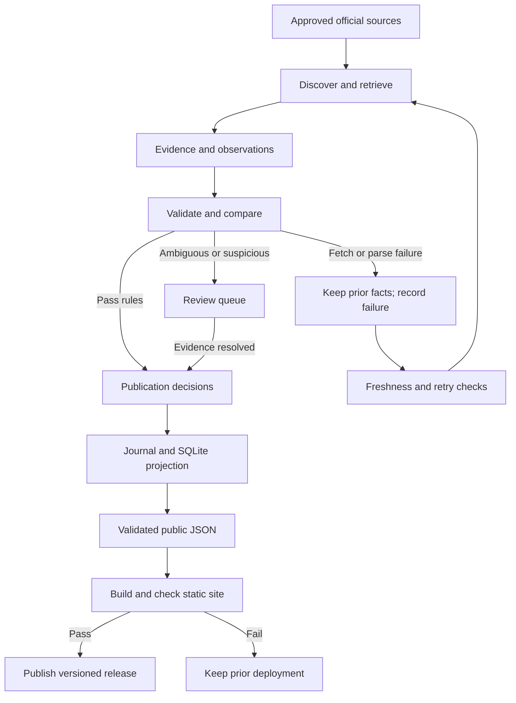

# RNtoNP.com: Living NP Program Directory

Implementation roadmap • Version 1.0 • October 19, 2026

Status: proposed development blueprint, ready for review. This document specifies the project; no application, scraper, repository, account, or deployment has been created. Estimates are planning judgments, not vendor quotes or measured benchmarks. Source links were consulted on October 19, 2026.

## Architectural assumptions that materially affect the plan

Proceed with these defaults. None needs to block the roadmap; confirm them before implementation changes production infrastructure.

| Decision | Working assumption | What changes if false |
|---|---|---|
| Existing RNtoNP.com | Its current application and hosting have not been inspected. Preserve the existing site. Use a preview deployment first. | An established framework or CMS may be cheaper to extend than adding Astro. Perform an integration audit before choosing production routing. |
| Product | Public, read-only educational directory; no accounts, payments, saved lists, or write API in the MVP. | User-specific features require authentication and persistent server-side services. |
| Freshness | Weekly source checks are useful; instant updates are unnecessary. | Daily or real-time guarantees require more reliable scheduling, monitoring, and expense. |
| Repository | Public code and publishable factual data are acceptable; restricted evidence stays out of public Git. | Private workflows have different quotas; private evidence may need a separate storage service. |
| Geography | “Located in Oklahoma” and “available to Oklahoma residents” are different filters. Tulsa campus claims require program-specific evidence. | A resident-eligibility directory requires earlier state authorization and licensure-disclosure work. |
| Program scope | Include NP preparation at MSN, DNP, and postgraduate certificate levels. Exclude generic nursing leadership, CNS, nurse anesthesia, and post-MSN DNP completion programs that add no NP preparation. | Broader APRN coverage needs a different taxonomy and eligibility rules. |
| Budget | Target $0 incremental monthly infrastructure for the pilot, excluding the existing domain, computer, internet, labor, and AI-assistant subscriptions. | Paid evidence storage, monitoring, or inference must have a separate approved ceiling. |
| Automation | Automate routine checks and well-supported updates; review first-time mappings and unresolved exceptions. | Fully unattended onboarding sacrifices defensibility. It is not a promised outcome. |

**Core recommendation:** Python ingestion → evidence and publication rules → SQLite working database → versioned JSON export → Astro static directory → Cloudflare Pages. Use GitHub Actions for scheduled execution. Keep AI optional and off in the initial pilot.

## A. Executive architecture recommendation

Use one repository and one scheduled batch pipeline. The public site serves prebuilt pages and a small search index. Visitors never query the ingestion database. University outages therefore cannot take down the directory.

SQLite is the working relational database, rebuilt from a versioned factual journal and seed configuration. It does not need a continuously running server. The journal preserves observations, decisions, and entity identifiers; the database is a queryable projection, not a second competing source of truth. This arrangement is appropriate for a single-writer pilot. SQLite itself documents single-writer limitations and appropriate embedded uses [1].

Use Astro for pre-rendered institution and program pages, with a small TypeScript search/filter component. Astro pre-renders routes by default [2]. This fits searchable educational content and keeps basic details readable without client-side JavaScript. React can be added for a component later; it is not a prerequisite.

Choose Cloudflare Pages for static hosting. Retain GitHub for version control and scheduling. GitHub Pages remains an alternative for a suitable noncommercial project, but its restrictions on online-business and transaction-oriented hosting make it a weaker default for a directory with possible commercial ambitions [3].

Start with explicitly approved source domains and a short seed list. Automate discovery of candidate program and tuition links within those domains. National institution discovery is a later milestone; a general-purpose web agent is unnecessary for the pilot.

**First usable slice:** one institution, one NP pathway, one correctly scoped tuition observation or an explicit unknown, source evidence, and a generated program page. Complete that slice before onboarding the rest of the pilot.

Portability boundaries:

| Deployment concept | Meaning here | Migration path |
|---|---|---|
| Static hosting | Serve generated HTML, CSS, JavaScript, and JSON. | Copy the build directory to another compatible host. |
| Managed cloud hosting | Provider runs infrastructure, builds, or databases. | Keep exports, environment configuration, and schema migrations portable. |
| Self-hosted database | You operate PostgreSQL on your own machine or rented server. | Import canonical records and journal; validate IDs, counts, and publication decisions. |
| Self-hosted scraping worker | Your machine runs the same Python commands on a schedule. | Replace Actions scheduling with cron/systemd; preserve logs and backups. |
| Fully self-hosted | You operate website, worker, storage, database, TLS, and monitoring. | Technically possible; adds patching, uptime, and backup work. Not the cheapest use of solo-developer time initially. |

Do not introduce Kubernetes, Redis, a vector database, a queue broker, a microservice fleet, or a managed database until a measured requirement justifies it.

## B. Technology decision matrix

Costs below refer to software or eligible infrastructure; effort is separate. Reliability ratings are suitability judgments for this project, not uptime guarantees.

| Component / option | Initial / recurring expense | Complexity and reliability | Scale / portability | Maintenance | Decision |
|---|---|---|---|---|---|
| Python + HTTPX + BeautifulSoup | $0 software / runner usage | Low; deterministic, testable on stable HTML | Batchable; highly portable | Source selectors need repair | Default retrieval/extraction |
| Playwright for retrieval | $0 software / more runner time | Medium; browser and timing failures | Portable, heavier | Higher than HTTP | Per-source fallback only |
| PDF text/table extraction | $0 software / runner time | Medium; reading order and merged cells can mislead | Portable | Fixtures essential | Add when a selected source requires it |
| AI extraction API | Usage-dependent | Medium/high; evidence still needs validation | Replaceable behind interface | Model/version regression work | Disabled in MVP |
| Local AI inference | Existing hardware may suffice / power and time | High setup for an uncertain benefit | Portable; hardware-dependent | Model operation and evaluation | Optional experiment later |
| SQLite + JSONL journal | $0 / storage | Low at pilot size; one writer | PostgreSQL migration possible | Backups and replay tests | Selected |
| Managed PostgreSQL, e.g. Supabase | Eligible free tier / paid upgrade | Medium; service dependency | Strong SQL portability; avoid proprietary coupling | Credentials, backups, quotas | Later if multiple writers/API needed |
| Self-hosted PostgreSQL | $0 software / machine expense | High operational responsibility | Strong portability and growth | Patching, security, recovery | Later, not MVP |
| Astro static output | $0 / static hosting | Low; HTML-first directory | Strong hosting portability | Small dependency surface | Selected, subject to existing-site audit |
| React + Vite SPA | $0 / static hosting | Low UI setup; route fallback and indexing need deliberate work | Portable | Additional prerender/SEO work for detail pages | Prefer only if existing site makes it clearly simpler |
| Next.js static export | $0 / static hosting | Medium; workable without a server | Portable static output; server features unavailable in export [4] | More framework concepts | Valid alternative, unnecessary by default |
| Next.js server application | Framework $0 / compute and storage | Higher; adds runtime failure surface | Scales with backend | More ongoing operations | Defer until dynamic features justify it |
| GitHub Actions standard Linux | Eligible public execution free / private quota or overage | Low setup; schedule is best-effort | Replaceable with local commands | Monitor missed runs | Selected scheduler |
| Cloudflare Pages | Eligible Free plan / review limits as usage grows | Low; static delivery independent of ingestion | Exportable site | Quota and deploy monitoring | Selected hosting |
| GitHub Pages | Eligible free / plan-dependent | Low; use restrictions must fit project [3] | Static output portable | Low | Alternative, not commercial default |

Supabase currently lists a 500 MB free database, inactivity pausing, and Pro starting at $25/month; free automatic database backups are not included [5]. These are reasons to avoid adding a service before it solves an actual problem.

Selected implementation tools: Python, HTTPX, BeautifulSoup, Pydantic, standard SQLite support, pytest; Astro, TypeScript, ordinary CSS, and browser tests for critical public behavior. Pin dependency versions during implementation, not to guessed versions in this roadmap.

## C. System architecture

Two distinct checkpoints protect publication: factual approval and release validation. A successful HTTP response or valid JSON is not enough to approve a fact. A factual update does not become public until the generated website passes checks.

A release manifest records code commit, data commit, schema version, rules version, build time, and content hash. Every displayed record can be traced to its approved observation and evidence version.

## D. MVP database schema and identity rules

### Row meaning

A program row represents a specific NP specialty pathway, credential, entry route, delivery variant, and campus context. A school can have several rows. A dual-specialty pathway remains one pathway with two specialty associations. Full-time versus part-time is not a new program unless the institution defines distinct offerings requiring different facts.

Use opaque, permanent UUID identifiers assigned on first acceptance. Do not derive identity from a name, URL, tuition amount, or mutable marketing label. Preserve a reviewed alias map when names change. Institution identifiers such as IPEDS UNITID may supplement identity when correctly matched; never invent them.

### Minimal tables

The eleven tables below avoid separate lookup tables for every enum and avoid separate history tables for every field. Each exists for an immediate requirement: identity, program distinctions, prices, evidence, or publication safety.

| Table | Key fields and types | Constraints and purpose |
|---|---|---|
| institutions | id UUID PK; name TEXT; website_url TEXT; city TEXT nullable; state CHAR(2) nullable; external_id TEXT nullable; status ENUM | State is institutional location, not eligibility. Names/domains are duplicate candidates, not infallible unique keys. |
| campuses | id UUID PK; institution_id FK; name, city, state TEXT; campus_key TEXT | UNIQUE(institution_id, campus_key). Add only documented physical sites. |
| programs | id UUID PK; institution_id FK; campus_id FK nullable; program_group_id UUID; name TEXT; credential ENUM; entry_route ENUM; delivery ENUM; offering_key TEXT; status ENUM | UNIQUE(institution_id, offering_key). Campus must belong to institution. Null campus does not assert online delivery. Group ID associates related offerings without merging them. |
| program_specialties | program_id FK; specialty_code ENUM | Composite PK. Controlled taxonomy; separate acute/primary and pediatric acute/primary specialties. |
| tuition_rates | id UUID PK; program_id FK; amount_minor INTEGER nullable; currency CHAR(3); unit ENUM; residency ENUM; charge_type ENUM; academic_year TEXT nullable; effective_start/end DATE nullable; applicability_text TEXT; rate_key TEXT; evidence_observation_id FK | Integer cents, no floats. UNIQUE(program_id, rate_key). A separate row per rate/residency/period/component. Approved projection only. |
| sources | id UUID PK; institution_id FK nullable; canonical_url TEXT; kind ENUM; access_status ENUM; refresh_days INTEGER; adapter_key TEXT; policy_checked_at TIMESTAMP | UNIQUE(canonical_url). Official university, accreditor, and discovery sources explicitly classified. |
| source_versions | id UUID PK; source_id FK; retrieved_at TIMESTAMP; content_hash TEXT; evidence_locator TEXT; retained_text TEXT nullable; blob_reference TEXT nullable; retention_class ENUM | UNIQUE(source_id, content_hash). Retain source heading/table/page context; a hash alone is not evidence. |
| runs | id UUID PK; started/finished_at TIMESTAMP; code_version TEXT; parser_version TEXT; rules_version TEXT; status ENUM; source_results JSON | Bounded per-source timestamps, request outcomes, counts, and failure codes. Includes successful unchanged checks. |
| observations | id UUID PK; run_id FK; source_version_id FK; entity_type/id; field_path TEXT; value_json JSON; null_reason ENUM nullable; applicability_json JSON; observed_at TIMESTAMP; effective_period JSON; observation_key TEXT | Immutable field or atomic-group observations. Repeated identical evidence/value/parser combinations deduplicate. Run history still records subsequent checks. |
| decisions | id UUID PK; observation_id FK; action ENUM; reason_code TEXT; reviewer_type/id TEXT; decided_at TIMESTAMP; rules_version TEXT; supersedes_id FK nullable | Append-only approvals, rejection, quarantine, revalidation, and withdrawal. No silent overwrite. |
| issues | id UUID PK; entity_id/source_id nullable; fingerprint TEXT; severity ENUM; status ENUM; opened/updated_at TIMESTAMP; detail JSON | One open issue per fingerprint. Used for errors, conflicts, and review tasks. |

Common projection fields on institutions/programs/rates: publication status, last_verified_at, and provenance map from field to approved observation ID. They are derived during replay, never edited directly. Relationships and specialty membership are also evidence-backed observations. Source-level timestamps live in run results; record timestamps reflect the evidence actually supporting that record.

Use ISO-8601 UTC timestamps. Preserve source dates as given and distinguish “2026–27” from an exact effective date; do not fabricate July 1 boundaries. Required identity fields must exist before publication. Optional factual fields can be null with reasons: not_published, not_found, ambiguous, not_applicable, or restricted. Unknown is not zero; an explicitly published zero remains possible but requires review.

Enums belong in versioned schemas: credential (MSN, DNP, postgraduate_certificate, other_reviewed), residency (resident, nonresident, all_students, unknown), tuition unit (credit, semester, term, year, whole_program), charge type (base_tuition, surcharge, mandatory_fee, bundled_total). Store semester-hour versus quarter-hour in applicability; never equate them automatically.

### Tuition rules

1. Amount, unit, currency, residency, applicable program/variant, and effective period form one atomic publication group. Do not combine a new price with an old unit or period.
2. Store a private institution's universal rate once as all_students when evidence supports it. Do not duplicate it as two residency rates.
3. A generic graduate rate is inapplicable until an official statement establishes that it covers this NP pathway and no exception supersedes it.
4. Nonresident charges may be an additional surcharge, not the total. Preserve components and combine only when the official structure explicitly requires it. OU's current tuition explanation illustrates this distinction [6].
5. Exclude living expenses from tuition. Keep mandatory fees separate. Do not expose a total-cost calculator in MVP.
6. When rates overlap for the same applicability and period, quarantine the conflict. A newer retrieval date alone does not establish precedence.
7. If the source lacks an effective period, retain the observation but label the period unknown; do not label it a current-year verified rate. Display “Current tuition not verified” with a source link.
8. Later estimates must store their input observation IDs, formula, assumptions, omitted fees, and calculation date. They remain explicitly estimated.

### Journal and persistence

Persist approved seeds, factual observation/decision events, bounded run summaries, and permitted evidence excerpts as versioned JSON/JSONL in a dedicated data branch. Build SQLite locally from those records on each run. Do not commit a changing binary database on every check. Keep current public exports and event segments partitioned by institution/month to avoid giant rewritten files.

Use one concurrency group for all writers, including manual reruns. Replay the latest data commit, stage changes, validate, then commit atomically. If the expected branch head changed, abort and recompute from the new head; never force-push over another writer. An interrupted run must leave either the previous valid journal or a complete new journal.

Public Git is durable version history, not an independent backup and not a place for unrestricted copies of university pages. Retain minimal attributable evidence only after source-policy review. Keep full permitted fixtures/snapshots outside the public journal when required. If durable retention is impermissible, record that extraction cannot be fully replayed from the original bytes; factual decision replay is still possible from retained lawful evidence. Do not claim universal byte-for-byte reproducibility.

At statewide expansion, add a program_campuses bridge only if one real offering needs several sites without duplication. Introduce normalized authorization, accreditation, admissions, and fee tables when those features are implemented. Experimental supplementary attributes may use schema-validated JSON; core filter fields and monetary facts remain typed.

## E. Phased development roadmap

Effort is focused human development/review time assisted by AI, not autonomous model runtime. Institution adapters are the largest uncertainty. Pilot estimate: 56–88 hours across M0–M4; add approximately 25% contingency, yielding roughly 70–110 hours. At six hours per week, that is about 12–19 weeks. These are estimates, not a deadline commitment.

### M0 — Scope, integration, and evidence inventory (4–6 hours)

- Objective: establish the smallest valid pilot and a safe integration target.
- Dependencies: this blueprint reviewed before application work begins.
- Tasks: inspect existing RNtoNP code/hosting; record production route decision; define eligibility and geography; create candidate/source manifests; review automated access and retention requirements.
- Deliverables: decisions, initial data dictionary, pilot manifest, and a short acceptance checklist.
- Tests: manually trace each candidate to an official current NP page; validate manifest shape and source-domain ownership.
- Acceptance: three target institutions or a documented evidence-based reduction; every source marked approved, blocked, or pending; no unresolved assumption hidden in a published claim; production integration choice recorded.
- Cost: $0 incremental infrastructure.
- Risks: an institution has no eligible current pathway; an existing site makes a new framework wasteful; source access is restricted. Replace/exclude candidates rather than fabricate coverage.

### M1 — One complete vertical slice (12–18 hours)

- Objective: publishable local output from one real institution, preferably Tulsa FNP.
- Dependencies: M0 source approval.
- Tasks: implement schema/replay, bounded HTTP retrieval, evidence capture, one parser, tuition applicability validation, public JSON export, and one local static detail page.
- Deliverables: repeatable local workflow, evidence-linked sample record, minimal page, and deterministic fixtures.
- Tests: correct mapping, unknown handling, duplicate rerun, missing tuition, incorrect generic price, and invalid evidence reference.
- Acceptance: a clean checkout can reproduce the record and page; every non-null public fact has evidence; running twice causes no duplicate facts; ambiguous tuition is withheld.
- Cost: $0 operating cost; no AI inference.
- Risks: source terminology differs between catalog and billing page. Record exceptions explicitly instead of weakening the schema.

### M2 — Multi-institution Tulsa pilot (12–20 hours)

- Objective: prove the shared pipeline across approximately 3–5 institutions where eligible.
- Dependencies: M1 passes.
- Tasks: add ORU and conditional OU sources; implement institution-scoped candidate link discovery; add only necessary PDF/browser support; audit all pilot NP offerings; add residency, credential, and specialty fixtures.
- Deliverables: reusable adapter interface, pilot dataset, source coverage report, and review queue.
- Tests: distinct same-school pathways; shared tuition sources; PDF row alignment if used; renamed URLs; duplicate institution aliases; campus/online classification.
- Acceptance: every included institution's target NP offerings have been manually enumerated and reconciled; no unsupported Tulsa presence; at least two institutions have an evidence-supported tuition rate; remaining gaps are explicit. Target three institutions, but accept two only with a documented eligibility/access reason and an independent third source-format test.
- Cost: $0 target; no paid services needed by default.
- Risks: onboarding cost rises with custom sources; OU Tulsa linkage remains unresolved. Keep OU out of the Tulsa-specific result set until proven.

### M3 — Public preview directory (12–18 hours)

- Objective: a useful searchable site built only from accepted records.
- Dependencies: M2 data contract.
- Tasks: institution/program pages, search, state and specialty filters, tuition units and period labels, source links, freshness/unknown display, canonical URLs, sitemap, and mobile layout.
- Deliverables: preview deployment and release manifest. Intended final route: RNtoNP.com/programs/ if compatible with its existing hosting; otherwise use a directory subdomain and link it from RNtoNP.com.
- Tests: direct deep links; no-JavaScript details; keyboard navigation; mobile layout; empty search; source links; quarantined-price exclusion; automated accessibility checks plus manual keyboard inspection.
- Acceptance: all pilot pages are crawlable HTML, filtering is correct, no critical accessibility findings in tested flows, all factual values trace to evidence, and a failed build retains the previous site. Production cutover remains a separate reviewed step.
- Cost: $0 eligible static hosting.
- Risks: root-domain deployment overwrites existing content; JavaScript-only detail pages reduce resilience. Audit routes and pre-render core content.

### M4 — Unattended operation and recovery (16–26 hours)

- Objective: graduate from a working scraper to a maintained directory.
- Dependencies: M3 preview and M2 truth fixtures.
- Tasks: daily due-work scheduler, retries, journal persistence, publication rules, stale rendering, exception reports, budget caps, independent heartbeat design, backup and restore, and safe deploy credentials.
- Deliverables: scheduled pipeline, operator runbook, monitoring report, recovery evidence, and production-ready release.
- Tests: timeout, 403/429, missing selector, HTTP-200 error page, changed currency/unit, suspicious increase, program disappearance, interrupted write, missed schedule, bad deploy, and restore from backup.
- Acceptance: at least three scheduled ingestion cycles spanning at least 14 days; zero unexplained losses; all injected unsafe updates blocked; clean restore reproduces the public data hash within 60 minutes; daily scheduler overdue beyond 48 hours is visible; all before-expansion gates below pass.
- Cost: $0 target; an independent alerting service may require a separately evaluated allowance.
- Risks: green jobs with empty extraction; silent missed schedules; raw evidence growth. Count expected facts, monitor age independently, cap retention.

### M5 — Oklahoma statewide coverage (16–30 platform hours plus 2–6 hours per additional institution)

- Objective: documented statewide coverage against an independent reference set.
- Dependencies: M4 reliability gate.
- Tasks: reconcile CCNE, ACEN, relevant official education lists, and university catalogs; classify each institution as eligible/excluded/unresolved; onboard all verified NP pathways; report institution and program completeness separately.
- Deliverables: dated Oklahoma candidate registry, coverage denominator, statewide directory, and omission report.
- Tests: registry diff, omitted-institution detection, false positive non-NP graduate degree, and program-level coverage reconciliation.
- Acceptance: 100% of the independently assembled candidate registry is adjudicated; at least 95% of verified eligible institutions are represented, with explicit reasons for gaps; at least 90% of enumerated eligible pathways have current identity evidence; at least 80% of pathways have current or explicitly period-qualified tuition. Report actual numerators and denominators, not “complete” marketing claims.
- Cost: target $0–$10/month infrastructure; spending requires a demonstrated need.
- Risks: accreditation directories are not exhaustive specialty-level NP censuses. Treat registry coverage as a measured proxy, not proof that no programs are missing.

### M6 — Regional reuse (12–24 platform hours plus onboarding time)

- Objective: validate portability across two neighboring states before adding many more.
- Dependencies: M5 gate and manageable review backlog.
- Tasks: select two states based on source availability; reuse adapters/configurations; separate institutional geography from resident eligibility; assess required custom code.
- Deliverables: two state inventories and an onboarding effort report.
- Tests: non-Oklahoma state values, different billing units, cross-state campuses, and no state-specific logic in generic modules.
- Acceptance: same reconciliation thresholds as M5 in both states; at least 70% of new sources use existing extraction strategies/configuration; median straightforward institution onboarding is at most four hours; maintenance remains within the agreed time budget for four weeks.
- Cost: planning envelope $0–$25/month, workload dependent.
- Risks: source variability defeats configuration reuse. Repair abstractions before geographic expansion rather than hiding increasing manual work.

### M7 — National baseline (40–80 platform hours plus measured per-institution onboarding)

- Objective: state-by-state national coverage without pretending discovery equals verification.
- Dependencies: M6 and measured cost/maintenance capacity.
- Tasks: batch states, run monthly registry discovery, prioritize stale or important sources, shard data/search where measured, and publish state coverage and limitations.
- Deliverables: national inventory across 50 states plus DC; territories separately marked in scope or not yet covered; national operations dashboard and recovery policy.
- Tests: cross-state deduplication, scheduling fairness, large rebuild/restore, and sampled field accuracy from each batch.
- Acceptance: every state/DC has a dated adjudicated registry; at least 95% of verified eligible institutions represented overall; program completeness shown separately; at least 90% of published critical facts within their freshness window; no high-severity unresolved publication defects; review backlog under 14 days for four weeks.
- Cost: model in H; national $0 operation is possible only under favorable assumptions, not a commitment.
- Risks: manual onboarding dominates. At 2–6 hours per institution, 1,200 institutions would mean 2,400–7,200 onboarding hours before reuse gains. The institution count is a sizing scenario, not a verified US census. Benchmark 20 institutions before promising nationwide dates.

### M8 — Enrichment and contributions (8–20 platform hours per coherent field group, plus research)

- Objective: add useful depth after baseline national coverage, without destabilizing facts.
- Dependencies: M7; small earlier additions allowed only when essential for correct identity/tuition interpretation.
- Tasks: implement one field contract at a time; add community correction intake with moderation; then comparison tools; accounts/API only for demonstrated demand.
- Deliverables: typed enrichment schema, evidence rules, refresh schedule, tests, and public display for each group.
- Tests: field-specific edge cases and calculations, backward compatibility, untrusted correction handling.
- Acceptance: 100% of displayed enriched values evidence-linked; no silent default values; human sample of at least 30 values across ten institutions with zero critical mismatches; correction cannot publish itself.
- Cost: incremental budget reviewed for each feature; no automatic new subscription.
- Risks: state disclosures and accreditation are nuanced; clinical placement claims may be promotional. Preserve exact scope and label uncertainty.

## F. First proof-of-concept implementation plan

### Candidate shortlist and source status

These are research-backed candidates, not a pre-approved production dataset. Program existence has stronger evidence than every campus, access-policy, and tuition-applicability detail. No source has been declared scrape-permitted simply because it appeared in search.

| Candidate | Official evidence found | Geographic handling | What must be resolved |
|---|---|---|---|
| University of Tulsa | Official FNP DNP page and 2026–27 graduate tuition schedule [7,8]. | Tulsa institution. Current FNP page describes online coursework; do not label it an in-person pathway merely from school address. | Cross-reference exact online offering and billing rate; check catalog and source policies. |
| Oral Roberts University | Official DNP page describes a BSN-entry FNP hybrid pathway with campus residencies [9]. | Tulsa institution, documented hybrid offering. | Identify current program-specific tuition and effective period; approve retrieval/evidence retention. |
| University of Oklahoma College of Nursing | Current BSN–DNP FNP page and 2026–27 program tuition index [10,11]. | Oklahoma institution and Tulsa pilot candidate. Current pathway-specific Tulsa delivery was not established by the pages reviewed. | Verify where this pathway is actually offered. Until then it can be an Oklahoma candidate, not a confirmed Tulsa-campus listing. |
| Graceland University — optional fourth test | Official admissions lists online MSN NP specialties; nursing page directs applicants to confirm state acceptance [12,13]. | Out-of-state online candidate; never a Tulsa-campus school. | Verify program-specific Oklahoma enrollment/clinical eligibility before describing it as serving Oklahoma residents. SARA membership alone is insufficient evidence for that claim. |

Do not pad the pilot to five institutions. Two fully evidenced local institutions plus a conditional third is more defensible than inventing Tulsa presence. A documented scope adjustment is acceptable; unnoticed geographic drift is not.

### Sequence within the pilot

1. Establish source manifest entries for official nursing program, catalog, and billing pages. Record reason, owner institution, access status, content type, refresh policy, and expected facts.
2. Start with Tulsa FNP. Retrieve its program page and tuition page, save permissible evidence with heading context, and map the exact offering.
3. Use Tulsa as a conflict test: its schedule includes a broader DNP rate and a separate online family-practice rate [8]. A parser that simply chooses the first DNP price must fail its fixture. Do not publish a tuition number from this roadmap as if already validated by the new pipeline.
4. Onboard ORU through the same interfaces. If its tuition is not unambiguously available, publish the verified program identity and an unknown tuition state.
5. Resolve OU's geographic classification and billing components before its Tulsa-specific inclusion. Its official index provides separate nursing cost documents; select the applicable document and distinguish tuition from estimated cost of attendance [11].
6. Add Graceland only if it teaches a useful format/applicability lesson and its classification is documented. Keep online eligibility separate from physical geography.
7. Audit all selected institutions' NP pathway lists against current catalogs. Record exclusions for CNS, anesthesia, leadership, and generic DNP completion pathways.
8. Run the pipeline, inspect every pilot fact, repeat with no changes, inject a controlled invalid update, and verify the old public value survives with an appropriate status.

Pilot discovery is real but bounded: automated link discovery on approved school domains, followed by deterministic candidate classification and review. Autonomous national school discovery is not a prerequisite to proving the end-to-end flow.

## G. Automation, verification, and quality design

### Pipeline contracts

| Stage | Input → output | Failure behavior |
|---|---|---|
| Discover | Approved directory/domain → candidate institution/program/source links | Candidate only; no automatic factual publication. |
| Retrieve | Approved URL → bytes, status, MIME type, timestamps, hash | Classify failure, retry eligible errors, keep previous data. |
| Extract | Document version + adapter → observations with exact evidence spans | Zero matches, missing context, and unexpected structure are explicit failures. |
| Normalize | Observations → typed candidates and controlled vocabulary | Preserve original label; unknown or conflicting meaning enters review. |
| Validate | Typed candidates + prior evidence → rule results | Schema, applicability, temporal, and anomaly checks must all pass. |
| Decide | Rule results → append-only accept/reject/quarantine decisions | AI confidence cannot override an evidence failure. |
| Persist | Events → committed journal and rebuilt SQLite | Transactional write; abort on invalid or conflicting state. |
| Export/build | Approved current projection → JSON + static pages | Reference/coverage checks block faulty release. |
| Deploy | Validated release → versioned static site | Failed deploy retains prior site; retry from committed data. |

### Publication state machine

Use separate dimensions for verification (pending, accepted, rejected, quarantined), freshness (current, stale, expired_period), and lifecycle (active, suspended, discontinued, unknown). A record can be accepted but stale; one enum cannot represent all three accurately.

| Situation | Decision and public behavior |
|---|---|
| New institution/pathway/source mapping | Human validates identity, scope, and applicability once. Then the recurring source can be automated. |
| Same approved fact and source evidence remains valid | Record successful revalidation; no new fact version or fake change. |
| Tuition change ≤10%, same unit/residency/variant, explicit current period, complete official evidence, no conflict | Eligible for automatic publication after pilot audit. This threshold is a review heuristic, not proof of accuracy. |
| Change >10%, zero price, unit/currency/residency change, or missing period | Quarantine new price. Retain prior supported value with its original period and verification date. |
| New year with clearly mapped rate | Add a new period-specific rate. Preserve prior-year history. A large change still requires review. |
| Future-effective rate | Show as upcoming if clearly dated; never replace the current period early. |
| Official pages conflict | Open one deduplicated issue. Do not choose solely by latest retrieval or AI preference. |
| Page missing, parser empty, redirect to generic homepage, HTTP-200 challenge | Extraction failure; do not mark successful verification or program closure. |
| Official discontinuation notice | Human-reviewed lifecycle update initially; preserve program history and dates. |
| Facts pass but release fails | Data remains committed; public site stays on prior release. Track publication lag separately. |

Automatically publish established program identity revalidations; require review for specialty/credential changes, merges, withdrawals, and new pathways during the pilot. This prevents a parser change from silently redefining a program.

### Refresh and failure policy

- Run a daily dispatcher at a non-hour-boundary UTC minute, for example 06:17 UTC. Select due sources rather than scraping everything daily.
- Tuition: every seven days; increase to twice weekly near a known rate rollover. Program identity/catalog: every 30 days. Discovery reference lists: monthly. Access-policy metadata: monthly and whenever access behavior changes.
- Pilot freshness defaults: tuition stale after 30 days without valid revalidation, program identity stale after 90. A known expired academic period is historical immediately, even if its page was fetched yesterday.
- Maintain last_attempted, last_successful_retrieval, last_successful_extraction, last_verified, and last_published separately. A 304 can support revalidation only if the retained content and approved parser/rules remain valid; otherwise perform a full retrieval.
- Start with one request per domain every two seconds, at most two global domains active, a 30-second request timeout, and three total attempts for transient failures. Honor stricter published limits and Retry-After. Use jittered backoff; stop on access restrictions rather than bypassing them.
- Limit source size, redirect count, total discovered links, execution time, and browser use. Allowlist destination domains and block private-network/loopback fetches, including redirected targets.
- Compare normalized factual blocks and parsed values, not just whole-page hashes. A footer timestamp should not create a tuition revision.
- Store expected section markers and extraction counts. If a previously populated source emits no programs or prices, flag it even when the process exits successfully.
- After three consecutive failures, raise severity; after seven days unresolved, investigate or reduce refresh pressure. Do not erase history.

GitHub warns that scheduled jobs can be delayed or dropped and public-repository schedules may be disabled after 60 days without activity [14]. Persist meaningful run summaries, support manual reruns, and document reactivation. A separate uptime/heartbeat checker is necessary for automatic alerts about a scheduler that never starts; the same scheduler cannot reliably monitor its own total failure. If no independent monitor is configured, state clearly that missed-run discovery depends on the operator or public stale-status display.

The website calculates age from verification timestamps in the browser and prints the absolute verified date in static HTML. A stale static build must not indefinitely say “fresh.” Include a visible dataset-generated date and an age-sensitive operational status indicator.

### AI use

MVP: no inference dependency. Later, run AI only for changed, ambiguous documents that deterministic strategies cannot parse. Send bounded relevant source text; treat all scraped instructions as untrusted data. Require a schema, evidence spans, units, periods, and explicit unknowns. Confirm cited spans actually occur in the retained document and refer to the correct program.

Record model identifier, prompt version, output, and validator results. Regression-test on a held-out labeled set before enabling a model version. A second model agreeing is not independent official confirmation. AI may draft a mapping or summarize discrepancies, but it must not authorize a new source, infer missing tuition, decide legal permission, or publish a disputed fact. Apply per-run and monthly spend caps; stop inference gracefully when capped.

### Access, retention, and contributions

Review each source's terms, robots directives, attribution, and retention constraints. Robots permission alone is not a legal determination. Prefer an offered API or downloadable dataset. If blocked, request a permitted export or obtain manually reviewed information; otherwise leave the field unknown and record the restriction. Do not circumvent logins, CAPTCHAs, or paywalls.

Public correction intake should initially be a GitHub issue template asking for record URL, proposed correction, and official evidence. Contributions produce candidate observations and never write directly to approved facts. Do not collect sensitive student information. Separate the repository's code license from the rights to factual data, excerpts, and third-party documents; do not assume a code license relicenses source content.

### Minimum tests before statewide expansion

All of the following are required, using saved permitted fixtures or carefully labeled synthetic cases for failure modes:

1. Correct institution/pathway/specialty extraction across at least three source patterns.
2. Distinction between NP tracks and non-NP graduate nursing programs.
3. Correct resident, nonresident, universal, surcharge, per-credit, and per-term handling.
4. Program-specific rate wins over an inapplicable generic rate; conflicts are quarantined.
5. Unknown remains null; an explicit zero does not become missing; numeric parsing uses exact cents.
6. Replaying/rerunning does not duplicate institutions, facts, tuition rows, or open issues.
7. URL/name changes preserve stable identity; unrelated same-name pathways stay separate.
8. Multiple tuition periods coexist; future and expired rates do not masquerade as current.
9. Fetch/parse failures cannot advance verification or remove a program.
10. Unsupported evidence references and atomic-group mismatches block publication.
11. Bad releases retain the prior deployment; interrupted writes retain a valid journal.
12. Clean restore/replay reproduces the approved export hash.
13. Search, filters, deep links, keyboard use, and unknown/stale displays behave correctly.
14. Scheduler heartbeat and over-budget failures surface visibly.

Manually audit every displayed pilot fact against official evidence before launch. Require zero critical mismatches; critical means wrong institution/pathway, tuition applicability, amount/unit, or falsely claimed current verification. Later audit all newly onboarded institutions and a rotating monthly sample of 10% of institutions, at least five where available. Tests prove implemented behavior, not universal factual correctness.

### Repository and solo-developer workflow

| Path | Responsibility |
|---|---|
| ingestion/ | Discovery, retrieval, adapters, normalization, validation, journal, export |
| schemas/ and migrations/ | Versioned field contracts and database changes |
| sources/ | Approved source manifest and institution configuration |
| tests/fixtures/ | Permitted source examples and explicit synthetic edge cases |
| web/ | Astro pages, components, styles, browser tests |
| ops/ | Replay, backup, restore, and release utilities |
| .github/workflows/ | CI, scheduled ingestion, and deploy orchestration |
| data branch | Factual journal, seeds, run summaries, public exports, release manifests |

Documentation: README.md for commands; ROADMAP.md for milestones; ARCHITECTURE.md for current boundaries; DATA_DICTIONARY.md for field meanings; DECISIONS.md for dated tradeoffs; CURRENT_TASK.md for one active task; CONTRIBUTING.md for evidence and review rules. Keep AI_INSTRUCTIONS.md short and use an AGENTS.md entry point referencing it when the chosen coding assistant supports that convention. Avoid duplicating the same rules across files.

One task at a time: select milestone → write objective, allowed files, non-goals, dependencies, acceptance checks → implement a small change → run relevant tests → review diff and evidence → update current task/decisions → commit → select next task. New feature ideas go to a backlog. A task cannot silently add a database service, framework, account system, or paid API. Prefer a short completed vertical slice to broad scaffolding with no usable result.

### Backup, secrets, and recovery

Use least-privilege repository and deployment tokens. Keep secrets out of public artifacts, logs, and browser bundles. Untrusted pull-request code must never receive production secrets. Pin third-party workflow actions by reviewed commit. A source adapter only extracts data; it must not execute fetched code.

Create a weekly portable backup of journal, schemas, manifests, and permitted evidence on a second independently controlled location/device. Retain four weekly and three monthly copies initially; verify checksums. Recovery objectives: no more than seven days of loss if the primary repository is lost, and restoration within 60 minutes for the pilot. Test restoration at M4 and quarterly thereafter. In-place bad-data rollback should be achievable from the previous data commit immediately.

Do not use expiring Actions artifacts or caches as the only database or evidence backup. Raw debugging downloads may expire after 30 days; evidence supporting published facts follows its separate documented retention policy. A static export alone cannot reconstruct the historical decision journal.

### Measurable scaling triggers

| Measured condition | Response before adding infrastructure |
|---|---|
| More than one necessary simultaneous writer, or replay exceeds five minutes for a week | Evaluate PostgreSQL as canonical operational storage; import journal, preserve IDs, compare exports, then switch one writer. |
| Repository approaches 250 MB, or evidence grows >50 MB/month | Move permitted large evidence to content-addressed object storage; retain pointers, hashes, and backup inventory. Thresholds are project choices. |
| Compressed search payload exceeds 500 KB or p95 filter response exceeds 200 ms on a representative mobile device | Shard by state/specialty or add a static search index; benchmark before a hosted search service. |
| Daily scrape batch exceeds 30 minutes | Parallelize across domains with a small worker pool. Preserve per-domain politeness and one final commit writer. |
| Due-work backlog stays over 24 hours for a week | Evaluate durable queue/worker scheduling; measure source restrictions before increasing concurrency. |
| Site build exceeds ten minutes or output exceeds 15,000 files | Reduce duplicate pages, shard output, then evaluate incremental generation or a different static host. |
| Onboarding needs custom code for >30% of new sources | Improve adapter taxonomy and source selection before expanding geography. |
| Maintenance exceeds two hours/week at pilot/state scale or review backlog exceeds 14 days | Pause expansion; fix high-volume failure sources or accept a larger explicit maintenance budget. |

These are intervention thresholds, not hard technology limits. Thousands of programs alone do not require PostgreSQL, Elasticsearch, or server-rendered pages.

### Enrichment field contracts for M8

The table defines the planned contracts now; implementing them waits for M8. Refresh intervals are proposed defaults. Every value also needs program applicability, evidence, and a verified date.

| Field | Preferred source | Data type | Validation and display rule | Refresh |
|---|---|---|---|---|
| Accreditation | Accreditor's official directory, with school cross-reference | Accreditor ID, status enum, covered credential, effective dates | Match exact institution and credential; do not infer specialty accreditation from institutional accreditation | 90 days |
| Program length | Current catalog/program plan | Minimum/maximum integer months, attendance basis | Preserve full-time/part-time assumptions; avoid converting semesters without a calendar basis | 90 days |
| Total credits | Catalog curriculum for the exact entry pathway | Decimal credits plus semester/quarter unit | Reconcile stated total with curriculum; distinguish transfer allowances | 90 days |
| Estimated total tuition | Accepted tuition components and credit/term requirements | Integer minor currency units plus formula and input IDs | Recalculate deterministically; show omitted fees and future-rate uncertainty; never call estimate official | On input change |
| Mandatory fees | Official bursar fee schedule | Charge rows with amount, unit, frequency, conditions | Separate one-time, recurring, clinical, and bundled fees; prevent double-counting | 30 days, seven near rollover |
| Application deadline | Current admissions page for cohort | Date/time, timezone if stated, cohort, deadline type | Distinguish priority/final/rolling; never assume midnight or timezone | Seven days while cohort open |
| Admissions requirements | Catalog/admissions policy | Typed requirement list plus original text | Match degree/entry route and cohort; avoid summarizing away alternatives | 30 days during admissions |
| GPA requirements | Admissions policy | Decimal threshold, scale, GPA basis, exceptions | Distinguish cumulative, prerequisite, and graduate GPA; do not compare different scales silently | 30 days during admissions |
| RN experience | Admissions policy | Minimum duration/hours, setting, required/preferred enum | Required and preferred remain distinct; record when requirement must be met | 30 days during admissions |
| Delivery format | Program/curriculum page | Online/hybrid/campus/unknown enum | “Online coursework” does not mean no campus attendance or no in-person clinical work | 30 days |
| Campus attendance | Program handbook/official schedule | Structured visit count, duration, location, conditions | Retain uncertainty and cohort differences; zero visits only with explicit evidence | 30 days |
| Clinical placement assistance | Official placement policy/handbook | Assistance categories plus bounded attributed explanation | Distinguish help, student-arranged placements, and an explicit guarantee; no invented strength score | 90 days |
| State authorization and eligibility | University's current disclosures plus relevant official regulator source | State, enrollment/placement/licensure dimension, status enum, dates | Each dimension separate; unknown stays unknown; participation in a reciprocity agreement is not a blanket licensure finding | 30 days and before eligibility claims |
| Full-time/part-time options | Catalog/program plan | Supported option set with conditions | Confirm pathway-specific availability; do not infer from total duration | 90 days |
| Certification eligibility | Exact program disclosure and certifier's published requirements | Certification body/exam IDs, claim type, qualifications | Distinguish school-stated preparation from independently assessed requirements; do not guarantee an individual applicant's eligibility | 90 days |

## H. Operating cost projections

### Workload model

Use N institutions, approximately five pathway offerings per institution, eight source URLs each, four source checks/month, and 25% allowance for retries/discovery. This yields about 40N requests/month. Actual mixed refresh schedules may be cheaper; catalogs and program pages can be checked less often than prices.

Assume about 120 runner minutes/month for builds/setup/CI plus 1.2N minutes for fetching/parsing: roughly 1.8 effective seconds per request across limited cross-domain concurrency. This is an illustrative HTTP-heavy model, not a benchmark. Browser-heavy or slow sources can multiply it. Assume 20% of the scheduled 32N retrievals produce meaningfully changed evidence, retaining an average 20 KB permitted evidence block: about 0.128N MB/month before overhead. Full PDFs can be far larger.

| Sizing scenario | Requests/month | Modeled runner minutes | Evidence growth/month | Annual evidence growth | Illustrative public transfer/month |
|---|---:|---:|---:|---:|---:|
| 5 institutions | 200 | 126 | 0.64 MB | 7.7 MB | 1 GB at 2,000 visits × 0.5 MB |
| 50 institutions | 2,000 | 180 | 6.4 MB | 77 MB | 10 GB at 20,000 visits × 0.5 MB |
| 500 institutions | 20,000 | 720 | 64 MB | 768 MB | 50 GB at 100,000 visits × 0.5 MB |
| Nationwide sizing example: 1,200 institutions | 48,000 | 1,560 | 154 MB | 1.84 GB | 250 GB at 500,000 visits × 0.5 MB |

Traffic assumptions are independent of institution count. The national row is deliberately a capacity scenario, not a verified count of US NP schools. This model excludes source images and storing repeated full-page snapshots.

### Monthly infrastructure budget

| Cost category | 5 schools | 50 schools | 500 schools | National scenario |
|---|---:|---:|---:|---:|
| Static hosting/CDN | $0 eligible | $0 eligible | $0 eligible if limits fit | $0 eligible if limits fit; reassess output/traffic |
| Database software/service | $0 SQLite | $0 SQLite | $0 SQLite still viable | $0 SQLite if one writer; optional managed PostgreSQL from $25/month [5] |
| Standard public Actions execution | $0 eligible | $0 eligible | $0 eligible | $0 eligible, subject to platform limits and acceptable use [15] |
| Evidence/backup/monitoring allowance | $0 with existing local backup | $0–$10 | $5–$25 | $10–$50 |
| AI inference | $0 default | $0 default | $0 default | $0 default |
| Practical planning envelope | $0 | $0–$10 | $5–$25 | $10–$75 with optional database |

Allowances are budget reserves, not researched quotes for a selected backup/monitoring vendor. They do not include labor, domain renewals, paid coding assistants, or buying hardware. Strict $0 at scale remains conditional on free-tier eligibility, existing backup resources, modest evidence retention, and tolerating best-effort scheduling.

Optional inference formula: monthly calls × ((input tokens × input price/million + output tokens × output price/million) / 1,000,000). If only 10% of changed documents use AI, calls are about 0.64N/month. At 1,200 institutions that is 768 calls. A hypothetical $0.01–$0.05 per completed call yields $7.68–$38.40/month before retries. These are sensitivity assumptions, not any provider's current prices; select and verify an actual model price only when enabling AI.

Relevant verified limits, to recheck before deployment:

- Cloudflare Pages Free lists 500 builds/month, 20-minute build timeout, 20,000 files/site, and 25 MiB per asset [16]. Its static requests are documented as free and unlimited, while functions have separate usage rules [17]. One daily build plus development builds is initially well below the build count, but “unlimited static requests” is not a guarantee against all service restrictions.
- Standard public GitHub Actions runner execution is free; private GitHub Free accounts have 2,000 included minutes and 500 MB artifact storage. The documented baseline Linux two-core rate is $0.006/minute [15]. Keep only short-lived diagnostic artifacts; evidence has its own persistence route.
- Under the model, 1,560 private runner minutes fit the included 2,000 only if other account usage leaves that allowance available. At five times the modeled runtime, 7,800 minutes would yield about $34.80 compute overage at $0.006/minute after a full 2,000-minute allowance. Storage is additional.

Set paid usage budgets to zero where enforceable in MVP. Add an application-level inference cap and workflow timeout as well. Stop optional processing on quota exhaustion and keep serving the previous verified release. Record measured source count, runtime, retained bytes, builds, and costs monthly; replace this model after four weeks of pilot observations.

## I. Risk register

Likelihood and impact are qualitative planning assessments. Owner is the solo maintainer unless otherwise assigned.

| Risk | Likelihood | Impact | Detection / mitigation |
|---|---|---|---|
| Correct-looking tuition belongs to another pathway | High | High | Exact applicability evidence, atomic groups, conflicting-price fixtures, initial human mapping. |
| University redesign silently empties parser | High | High | Expected markers/counts; HTTP-200 error checks; never treat empty as closure. |
| Geography conflates campus and online eligibility | High | High | Separate attributes and evidence; no inferred Tulsa presence. |
| Discovery misses schools or specialties | High | High | Independent registry reconciliation and separate institution/program denominators. |
| Human exception volume exceeds available time | High | High | Measure onboarding and weekly maintenance; pause growth at backlog threshold. |
| Scheduled workflow never starts | Medium | High | Independent heartbeat, visible dates, manual rerun and reactivation runbook. |
| AI fabricates or follows instructions in a source | Medium if enabled | High | Optional AI, bounded untrusted text, evidence-span validation, no source-driven tool execution. |
| Historical rates shown as current | Medium | High | Academic period and effective-date rules separate from retrieval freshness. |
| Competing jobs corrupt canonical state | Medium | High | Single writer, compare expected commit, transactional staging, replay tests. |
| Evidence disappears or cannot be lawfully retained | Medium | High | Source-specific retention decision, minimal evidence, explicit reproducibility limits, permitted alternatives. |
| Free-tier policy/quota changes | Medium | Medium | Monthly usage review, zero spend caps, portable commands/export, published cost dependencies. |
| Public repository leaks secrets or private submissions | Low/medium | High | Secret scanning, minimal tokens, untrusted-PR isolation, no sensitive intake fields. |
| Existing website overwritten at deployment | Medium before audit | High | M0 integration audit, preview first, separate route/subdomain, rollback. |
| Scope expands into rankings/calculators/accounts | High | Medium | One active task, milestone gates, backlog, explicit feature budget. |
| Malicious or mistaken community correction | Medium later | High | Evidence-required intake and moderated decisions; no direct publish access. |

## J. Immediate next steps — first five development tasks

Execute only after this blueprint is reviewed. Each task is a separate reviewable change; none authorizes overwriting the current production website.

| Order | Small task | Output | Acceptance check | Estimate |
|---|---|---|---|---:|
| 1 | Audit current RNtoNP repository/hosting and record the MVP boundary | ARCHITECTURE.md, first DECISIONS.md entry, CURRENT_TASK.md | Existing framework, build/deploy owner, directory route, and preview strategy documented; no production change | 1–2 h |
| 2 | Create the three-candidate source/eligibility manifest | Source manifest plus short data dictionary | Every candidate has official NP evidence and explicit geography/access/tuition status; OU remains conditional if unresolved | 2–3 h |
| 3 | Define minimal institution/program/tuition/evidence contracts and journal replay skeleton | Versioned schemas, local SQLite initialization, fixture records | Valid sample accepted; missing evidence, malformed units, and ambiguous applicability rejected; repeat replay stable | 2–4 h |
| 4 | Implement one bounded HTTP retrieval adapter for the approved Tulsa pages | Fetch result and evidence/version records | Timeout, redirect, non-HTML, changed content, and unchanged content handled without inventing successful verification | 2–4 h |
| 5 | Extract one Tulsa FNP offering and export its accepted facts | Tested parser, publication rule, JSON export | Correct program mapping; generic-versus-specific rate ambiguity handled; null tuition permitted; identical rerun deduplicates | 3–5 h |

The next task after these five is the single local detail page that completes M1. Expand institutions only after that page can be rebuilt from evidence and the saved journal.

## Source register

Primary sources consulted October 19, 2026. Provider policies and school offerings can change. The roadmap's thresholds, budgets, architecture judgments, and effort estimates are proposals, not claims made by these sources.

1. [SQLite, Appropriate Uses](https://www.sqlite.org/whentouse.html)
2. [Astro, On-demand Rendering / default pre-rendering](https://docs.astro.build/en/guides/on-demand-rendering/)
3. [GitHub Pages limits and use restrictions](https://docs.github.com/en/pages/getting-started-with-github-pages/github-pages-limits)
4. [Next.js static exports](https://nextjs.org/docs/app/guides/static-exports)
5. [Supabase pricing and plan features](https://supabase.com/pricing)
6. [OU 2026–2027 tuition explanation](https://ou.edu/sfc/2026-2027-tuition-increase)
7. [University of Tulsa FNP](https://utulsa.edu/academics/health-natural-sciences/academics/departments/nursing/family-nurse-practitioner/)
8. [University of Tulsa graduate cost schedule](https://utulsa.edu/tuition-aid/tuition-costs/cost-graduate/)
9. [ORU DNP](https://oru.edu/academics/online/graduate/doctor-of-nursing-practice.php)
10. [OU BSN–DNP FNP](https://nursing.ouhsc.edu/programs-academics/doctor-of-nursing-practice/bsn-to-dnp-family-nurse-practitioner)
11. [OU current program tuition index](https://financialservices.ouhsc.edu/departments/bursars-office/tuition-fees/tuition-and-fees-archives/current-year-tuition-and-fees-by-program)
12. [Graceland MSN admissions](https://www.graceland.edu/admissions-aid/graduate-admissions/msn-admissions/)
13. [Graceland School of Nursing / state acceptance information](https://www.graceland.edu/academics/school-of-nursing/)
14. [GitHub scheduled workflow behavior](https://docs.github.com/en/actions/reference/workflows-and-actions/events-that-trigger-workflows#schedule)
15. [GitHub Actions billing](https://docs.github.com/en/billing/concepts/product-billing/github-actions)
16. [Cloudflare Pages limits](https://developers.cloudflare.com/pages/platform/limits/)
17. [Cloudflare Pages pricing](https://developers.cloudflare.com/pages/functions/pricing/)
18. [CCNE official program directory entry point](https://www.aacnnursing.org/ccne-accreditation/find-accredited-programs)
19. [ACEN official program search](https://www.acenursing.org/search-programs)

Use CCNE [18] and ACEN [19] as independent discovery inputs, then verify current NP pathways on university sources. Neither institutional accreditation nor a graduate-nursing listing alone establishes every NP specialty, campus, admissions status, or tuition rate.
